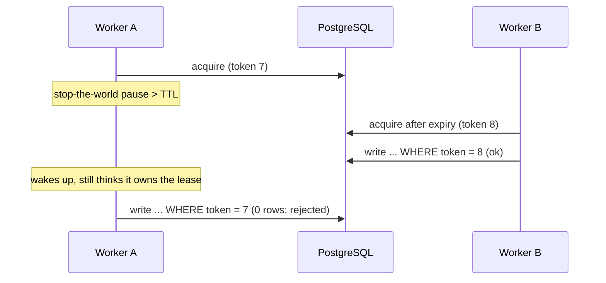
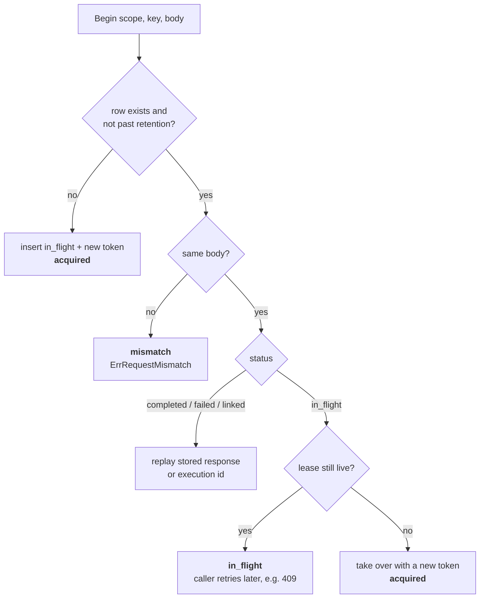
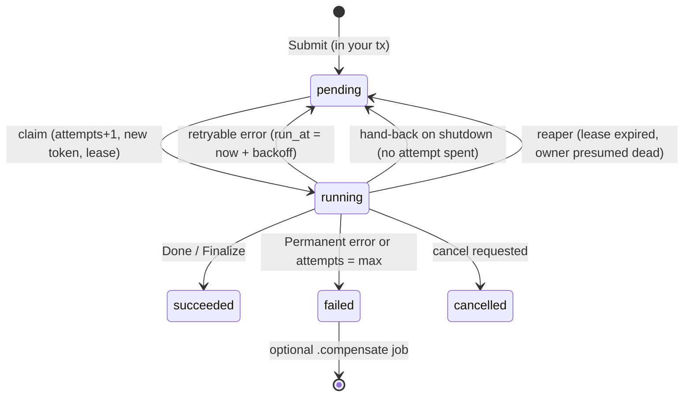
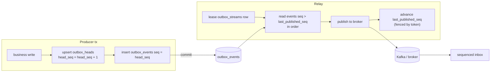
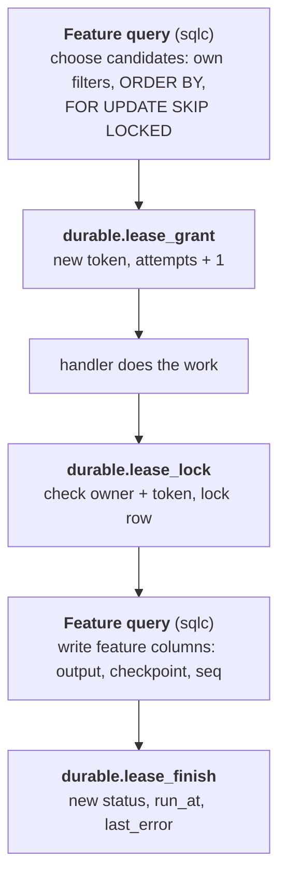

# Durable Work on PostgreSQL: A Learning Guide

Alex Tan · 14 October 2026. Companion to the [design](design.md), [decisions](decisions.md), [failure modes](failure-modes.md) and [scenarios](scenarios.md).

## 1. Why this exists

Most backends hit the same problem many times. Something must happen **once**, or at most **one worker at a time**, even though processes crash, networks drop replies, and clients retry. Common examples:

- Charge a card once, even when the client sends the same request twice.
- Run a long export or a call to a slow partner API on exactly one worker, and pick it up again if that worker dies.
- Publish an `order.paid` event only if the order write committed, and publish events for one order in order.
- Apply an incoming webhook once, even when the sender redelivers it.
- Fire a cron job once per tick, however many schedulers run.

Tools like Temporal, Kafka transactions or Redis locks each solve part of this. `postgres/durable` solves it **with the PostgreSQL database you already have**. That has one big advantage: the bookkeeping ("this ran", "this is mine", "this is the next event") can commit **in the same transaction** as your business data. Either both happen or neither does, so there is no dual write.

The module was built from scratch in `github.com/alextanhongpin/dbtx/postgres/durable` (branch `feat/postgres-durable`). It has one shared lease engine, one fencing-token sequence and one error vocabulary, and on top of those come eight packages: `lease`, `txlock`, `keys`, `jobs`, `outbox`, `inbox`, `schedule` and `cache`.

**What you will learn:** how to hold exclusive ownership without holding a transaction open; why a lease alone is not enough (fencing); how idempotency, retries, ordered events and caches all reuse the same few ideas; and how they break under stop-the-world pauses.

**Prerequisites:** PostgreSQL transactions and row locks (`SELECT … FOR UPDATE`), Go `context`, and `database/sql`.

## 2. Five core ideas

Everything else in this guide combines these five ideas.

1. **Lock vs lease.** A *lock* is exclusive ownership that lasts as long as a transaction or connection. A *lease* is exclusive ownership recorded in a row, with an expiry time. A lease survives across transactions, so long work never keeps a transaction open.
2. **Fencing token.** Each time a lease is granted it gets a number that only goes up. Every write the holder makes carries the token. The database refuses a write whose token is no longer current, so a holder that was paused and lost its lease cannot do damage.
3. **Idempotency key.** The caller names a request (`scope`, `key`). The first request records the input. Later requests with the same key get the stored result, or `ErrRequestMismatch` if the body is different.
4. **Durable state machine.** Work is a row with a `status`, `attempts`, `run_at` and `last_error`. Retrying means moving the row back to `pending` with a later `run_at`. A crash leaves the row in `running` with an expired lease, and the reaper picks it up.
5. **Commit with the business change.** Bookkeeping writes join the caller's transaction (through `dbtx.DBTx(ctx)`), so "done", "event queued" and "message applied" commit or roll back together with the domain data.

### The guarantee you actually get

No system gives exactly-once *effects* across a network. What this module gives you:

| Scope | Guarantee |
| --- | --- |
| Accepting a request | Once per (scope, key) within the retention window |
| Local effects committed with the outcome | Effectively once |
| Remote calls | At least once. In effect once when the remote API honours the idempotency key that `RunStep` sends |
| Outbox delivery | At least once. Pair it with a sequenced inbox for in-order, once-only processing |
| Leases | Two holders never both write inside a fenced transaction. Activities can overlap after expiry, so their writes must carry the token |

### Who decides time

**The database clock decides when a lease has expired**, using `clock_timestamp()` read after the row lock is taken. Each worker also keeps a conservative local deadline on Go's monotonic clock: *request start + TTL − TTL/6*. The worker stops itself before the database would consider it expired. Clock skew between machines therefore never extends a lease.

## 3. Transaction locks vs leases

### Transaction-scoped advisory locks (`txlock`)

Use a transaction lock when the protected work is **short and lives entirely in one transaction**:

```sql
BEGIN;
SELECT durable.set_local_timeouts('5s');           -- SET LOCAL lock_timeout
SELECT pg_advisory_xact_lock(hashtextextended('inventory:sku-42', 0));
-- read, decide, write
COMMIT;                                              -- lock released automatically
```

- The lock is released on COMMIT, on ROLLBACK, or when the connection dies. Nothing can leak.
- `pg_try_advisory_xact_lock` returns false instead of waiting (`TryWithLock`).
- `WithLocks` **sorts and de-duplicates** keys before locking them. Two callers that lock {A, B} and {B, A} then always take A first, so they cannot deadlock.
- `lock_timeout` turns an endless wait into a SQLSTATE `55P03` error.

```go
err := locker.WithLock(ctx, "inventory:sku-42", txlock.Options{Wait: 5 * time.Second},
    func(txCtx context.Context) error { return reserve(txCtx, sku, qty) })
```

**Limit:** the transaction must stay open for as long as the work runs. That rules out calling a slow HTTP API, running a 10-minute export, or anything that should survive a reconnect.

### Leases (`lease`)

A lease is a row:

```sql
CREATE TABLE durable.leases (
  namespace text, key text,
  owner_id  text,          -- NULL = free
  token     bigint,        -- per-key generation, only increases
  expires_at timestamptz,  -- NULL = no lease
  PRIMARY KEY (namespace, key));
```

`durable.acquire_lease` runs in one short transaction:

1. Take `pg_try_advisory_xact_lock` on the key (so two first-time acquirers do not both INSERT), then `SELECT … FOR UPDATE NOWAIT`.
2. Read `clock_timestamp()` **after** the lock. If the row has an owner and has not expired, return 0 (busy).
3. Otherwise set `owner_id`, `token = token + 1` and `expires_at = now + ttl`, and return the new token.

The transaction then commits, and **no transaction stays open while the work runs**. The holder keeps the lease alive by heartbeating:

```sql
UPDATE durable.leases SET expires_at = clock_timestamp() + ttl
WHERE namespace=$1 AND key=$2 AND owner_id=$3 AND token=$4
  AND expires_at > clock_timestamp();   -- strict: an expired lease cannot be revived
```

The Go `Keeper` (`internal/engine/keeper.go`) heartbeats every **TTL/3**. If a renewal fails, or the local deadline passes first, it cancels the work's context with `ErrLeaseLost`.

### Two ways to use a lease

| API | Shape | Use for |
| --- | --- | --- |
| `Activity(ctx, key, fn)` | Acquire, heartbeat while `fn` runs outside any transaction, release | Long work, remote calls |
| `RunInFencedTx(ctx, key, fn)` | Acquire, then one transaction that **locks the lease row** and checks owner and token before running `fn` | A short guarded write that must not overlap with a successor |
| `held.RunInFencedTx` | Inside an activity: open a fenced transaction for one write | Writing results from long work |

Inside a fenced transaction the row lock means no successor can take the lease until you commit. That is why the strict-expiry rule has a **row-lock exception**: owner and token are enough there.

### Rule of thumb

- The work fits in one transaction and takes milliseconds → `txlock`.
- The work is long, crosses a network call, or must survive a reconnect → a `lease` activity, and every side effect carries the fencing token (next section).

## 4. Fencing and the stop-the-world problem

### Why a lease alone is not enough

Think of a lease as a promise that *expires*. The holder cannot tell when it has stopped running. A garbage-collection pause, CPU throttling, a VM migration or `SIGSTOP` can freeze a process for longer than its TTL. When it wakes up it still *believes* it holds the lease:



The fix is a **fencing token**. Each grant gets a strictly larger number, and **every write checks it in the database**:

```sql
UPDATE durable.executions SET status = 'succeeded', result = $5
WHERE id = $1 AND owner_id = $2 AND token = $3
  AND lease_expires_at > clock_timestamp();   -- strict expiry (D7)
-- 0 rows affected  =>  ErrLeaseLost / ErrFenced
```

A local check such as "is my context still alive?" is a race. Only the database decides who owns the row at the moment of the write.

### Token domains

- **Resource leases** (`durable.leases`): a per-key generation (`token + 1`). Those rows are never purged, so the counter never resets.
- **Everything else** (keys, executions, outbox streams, cache versions): a global sequence, `durable.fencing_seq`. Those rows *are* purged, and a sequence never reissues a value after a key is reused.

### Remote side effects

The database can only fence its own writes. For a remote system, pass the token or a stable idempotency key along, and have the remote reject anything older ("write if token > last seen") or deduplicate on the key. If the remote does neither, the best you can get is *at least once*.

### Failover: tokens must never go backwards

With asynchronous replication, a promoted replica can be missing the last committed `nextval`s, so it could **reissue a token that was already used**. After promoting a replica or restoring a backup, run this before workers resume:

```sql
SELECT durable.advance_fencing();   -- default gap 1e9: bumps the sequence and every lease generation
```

### Defences in depth against pauses

| Defence | Where |
| --- | --- |
| Heartbeat every TTL/3, so two consecutive misses still leave time | `Keeper` |
| Watchdog: cancel the work context at the local deadline even if the heartbeat goroutine is starved (FM-3) | `Keeper.Supervise` |
| Strict expiry: an expired lease can never be renewed back to life | `renew_lease`, `lease_renew` |
| Owner + token + unexpired lease checked on every write | every query after a claim |
| Never report success after a loss, even if the handler ignored cancellation (FM-4) | `jobs` worker |
| `durabletest.Gate` + `durable.Hooks` freeze a worker at an exact point in tests | `BeforeComplete`, `BeforeHeartbeat`, `AfterRemoteCall`, … |

## 5. Idempotency: accept a request once

The `keys` package implements the `Idempotency-Key` header pattern. One row per (scope, key) holds the **input** and later the **output**. This is the "first entry is the input, second is the output" idea, done as one row that changes state:

| Column | Meaning |
| --- | --- |
| `scope`, `key` | Primary key. Put the tenant and operation in the scope, e.g. `t1:payments.create` |
| `request jsonb` | The first body, compared with jsonb equality (key order and whitespace do not matter) |
| `status` | `in_flight` → `completed` / `failed` / `linked` (owned by a job) |
| `owner_id`, `token`, `lease_expires_at` | A short **lease** on the in-flight request |
| `response jsonb` | Stored status, headers and body to replay |
| `expires_at` | Retention: after this, the key can be reused |

### `durable.begin_key`: one round trip, five outcomes



Two details make this safe:

- An insert race (two first requests at the same time) is caught as `unique_violation`, and the loser re-reads the winner's row.
- A request whose process crashed leaves an in-flight row with an expiring lease. A retry then **takes over with a higher token**, and the crashed request's late `Complete` is rejected (FM-16).

### Using it

```go
resp, err := k.Do(r.Context(), keys.Request{Scope: "t1:payments.create", Key: hdr, Body: body},
    func(txCtx context.Context) (keys.Response, error) {
        // business writes through db.DBTx(txCtx) ...
        return keys.Response{Status: 201, Body: out}, nil
    })
```

- `Do` = `Begin` → run `fn` in a transaction → `Complete` **in that same transaction**, fenced. The response and the business writes commit together.
- Failure policy (Q1): an error wrapped in `durable.Permanent` that comes with a response status is **stored** (for example a 422 replays as a 422). Any other error, or a panic, **releases** the key so the client can retry right away.
- The lower-level `Begin` / `Complete` / `Fail` / `Release` let you span several steps. While you hold the claim, it heartbeats in the background.
- With no client key, `keys.Derive("order", id, "refund")` builds one from business identifiers.

### Remote idempotent APIs

The same idea extends outwards. When your step calls Stripe or a partner API that accepts an idempotency key, send a **stable** key derived from your own state (in `jobs` it is `execution_id:step_name`), and **save the exact request before sending it**. A retry then resends byte-for-byte the same request with the same key, and the remote deduplicates it. The remote's retention window bounds the guarantee: retry after it expires and you may get a second effect.

## 6. Retries and jobs

A job is a row in `durable.executions`, and retry state lives on that row. The idempotency key is kept in a **separate** table (D2), because keys and executions have different lifetimes and synchronous requests need keys without jobs.



### Submitting

`Submit` joins the caller's transaction, so "order created" and "fulfil order" commit together. With a `Key`, the idempotency row (`status = linked`) and the execution are written in **one transaction**, so a crash between them is impossible (FM-18). Submitting the same key again returns the existing execution.

### Claiming

```sql
SELECT * FROM durable.lease_grant('durable.executions',
  ARRAY(SELECT id FROM durable.executions
        WHERE queue = $1 AND kind = ANY($2) AND status = 'pending' AND run_at <= now()
        ORDER BY run_at LIMIT $3 FOR UPDATE SKIP LOCKED),
  $owner, $ttl_us, 'pending', 'running', true);   -- count_attempt = true
```

- `SKIP LOCKED` lets many workers claim different rows without blocking each other.
- **Attempts are counted at claim, not at failure.** A poison job that crashes the process on every attempt still runs out of attempts (FM-6).
- Backoff: exponential from 1s, doubling up to 1h, with up to 25% jitter, so a retry storm after an outage spreads out (FM-32). `durable.RetryAfter(err, d)` honours a remote `Retry-After`.

### Two execution modes

|  | `ModeTx` | `ModeActivity` |
| --- | --- | --- |
| Where the handler runs | Inside a transaction that **row-locks** the execution | Outside any transaction; heartbeats keep the lease |
| Progress | `jobs.Next(name, data)` saves a checkpoint **in the same commit** as the step's writes | `RunStep` saves remote requests and responses |
| Completion | Commits with the last step's writes | `x.Finalize(ctx, fn)` runs `fn` and the completion in one fenced transaction |
| Longer than the TTL? | Yes (the row lock blocks successors) | Yes, if heartbeats keep up |
| Remote calls | Not allowed (`ErrRemoteStepInTx`) | Yes |
| On a crash | The step rolls back; resume from the last checkpoint | Resume; finished `RunStep`s replay their saved responses |

The mode is **fixed at the first claim** (D8), so a deploy that changes a kind's registration cannot switch a half-done execution.

### `RunStep`: remote calls that survive pauses

```go
charge, err := x.RunStep(ctx, "charge",
    func(ctx context.Context) (ChargeReq, error) { return buildCharge(order), nil },
    func(ctx context.Context, key string, req ChargeReq) (Charge, error) {
        return stripe.Charge(ctx, key, req)   // key = "<execution_id>:charge"
    })
```

1. First attempt: `build` creates the request, which is **saved** (fenced) before `call` runs.
2. Crash or pause after the remote call but before the response is saved (FM-2): the next attempt **resends the saved request** with the same key, and the remote deduplicates it.
3. Once the response is saved, later attempts return it without calling the remote at all.

### Shutdown, cancel and compensation

- **Drain (FM-31):** on SIGTERM, workers wait up to 25s. Activity work still unfinished after that is **handed back** (`run_at = now`, lease cleared, attempt refunded) instead of waiting for the lease to expire.
- **Outcome precedence (D19):** a success is always recorded, even when it races with shutdown. Then permanent failures. Only then are cancel requests honoured, and a retry scheduled after a cancel request becomes `cancelled`.
- **Compensation (Q9):** `KindOptions.Compensate` submits `<kind>.compensate` in the same transaction that records the final failure, including failures the reaper finds.
- **Reaper:** each worker reaps only expired executions of the kinds it registered, so one service never fails another team's jobs.

## 7. Outbox and inbox: events in order

### The outbox in one sentence

Write the event row **in the same transaction** as the business change, and let a relay publish it afterwards. The event exists if and only if the change committed. Delivery is at least once, because the relay can crash after publishing and before recording that it did.

### Unordered topics

This is simply a job queue for events. Relays claim batches with `lease_grant` + `SKIP LOCKED`, publish them, and mark them published. If the publisher accepts a prefix of the batch, **only the first rejected event spends an attempt** and the rest go back to pending (D16). One poison message cannot kill the whole batch behind it.

### Ordered topics: a gapless sequence per aggregate

Ordering needs two things: a sequence number per aggregate (`order:123` gets 1, 2, 3, …) and a **single relay per stream** at a time.



Why is the sequence **gapless and in commit order** (FM-19)? The upsert on `outbox_heads` row-locks that aggregate's head until the producer commits. A second producer on the same aggregate waits, then takes the next number. If the first producer rolls back, its increment rolls back with it, so no gap is left.

Why are **heads and streams separate tables** (D11)? A producer holds the head row lock until its transaction ends. If relays heartbeated that same row, one slow producer could make a relay lose its lease.

The relay advances `last_published_seq` with a **fenced** update. A relay that was paused mid-batch (FM-21) finds that its token is stale, and its advance is rejected. The broker may still end up with duplicates or interleaved events. That is expected, and the inbox handles it.

### When the head event keeps failing

| Policy | Behaviour |
| --- | --- |
| `HeadBlock` (default) | The stream stops and alerts; other streams continue |
| `HeadPark` | Dead-letter the event and publish a **gap marker**, so consumers can move on |
| `HeadStop` | Stop until an operator runs `Resume` |

Shutdown or a lost lease **never** spends attempts or parks a head. Admin operations (`Resume`, `Skip`, `Replay`) **issue a new token** to fence out the current relay (D18). Without that, a relay could advance past events that `Replay` had just re-queued.

### The inbox: applying messages once

| Mode | Rule | Use when |
| --- | --- | --- |
| `ModeDedup` | Insert `(source, message_id)`; a conflict means duplicate | Order does not matter |
| `ModeSequenced` | Apply only `seq = last_applied + 1`; buffer anything later | Per-aggregate order matters |
| `ModeVersioned` | Apply only if `version > last_version` (newer wins) | You only need the latest state |

In **sequenced** mode, a message that arrives early (`seq > last + 1`) is stored in `inbox_pending` and **acknowledged** (D10). Refusing it would stall a whole Kafka partition. When the missing message arrives, the buffered messages are applied in order, each in its own **savepoint** (`RunInSubTx`), so one bad message does not undo the others. `Gaps` lists streams that are waiting, `SkipGap` gives up on a missing range, and `Drain` retries buffered messages that failed.

The dedup or sequence record is written **in the same transaction as the handler's writes**. If the handler rolls back, the record rolls back too, and redelivery processes the message again (FM-26). `Enqueue` is store-and-forward: it records the message and submits a job in one transaction, so slow handling never blocks the consumer.

End-to-end property tested in `inbox.TestOrderedOutboxIntoSequencedInbox`: two relays (one paused mid-batch) feed a sequenced inbox, which applies exactly 1..N once each, in order.

## 8. Scheduler and cache: the same ideas, reused

### Scheduler: one job per tick

The scheduler adds almost nothing of its own. It is **idempotent job submission with a deterministic key**:

```
key = "schedule:" + name + "@" + tick.Format(time.RFC3339Nano)
```

Run ten scheduler instances and each one computes the same due ticks and calls `Submit` with the same key. Idempotency (section 5) makes exactly one of them win (FM-27). No leader election is needed. Using nanosecond precision in the key matters: with second precision, two `@every 500ms` ticks would collide.

- **Cron:** five fields, descriptors (`@daily`), `@every 5m`, and IANA time zones (DST is handled by computing in the schedule's location).
- **Missed runs** after downtime (FM-28): `MissedLatest` (default, runs once for the newest missed tick), `MissedAll` (one job per missed tick, caught up across several passes), `MissedNone`.
- **Overlap:** `OverlapSkip` (default: skip the tick if the previous execution is still unfinished), `OverlapQueue`, `OverlapAllow`.
- The schedule row stores `next_run_at` and `last_execution_id`, and advancing it happens in the same transaction as the `Submit`.

### Cache: a lease on *computing* a value

The cache reuses three ideas: a lease (who is computing), the fencing sequence (which value is newer), and the database clock (what is fresh).

```sql
-- ClaimCompute: only if nobody holds a live compute lease AND no fresh value exists
INSERT INTO durable.cache AS c (key, compute_owner, compute_expires_at) VALUES ($1, $2, now() + ttl)
ON CONFLICT (key) DO UPDATE SET compute_owner = EXCLUDED.compute_owner, ...
WHERE (c.compute_owner IS NULL OR c.compute_expires_at <= clock_timestamp())
  AND NOT (c.value IS NOT NULL AND c.expires_at > clock_timestamp())
RETURNING nextval('durable.fencing_seq') AS token;

-- StoreComputed: versioned write, older computations lose
UPDATE durable.cache SET value = $v, version = $token, ...
WHERE key = $1 AND version < $token;
```

`c.GetOrCompute(ctx, key, opts, fn)` therefore behaves like this:

| State | What the caller gets |
| --- | --- |
| Fresh value | Returned immediately |
| Stale but within `stale_until` | Served stale; one caller recomputes in the background (stale-while-revalidate) |
| Nothing usable, someone else computing | Wait (poll every 50ms) up to the compute TTL, then compute anyway (Q6) |
| Nothing usable, nobody computing | Claim, compute, store with the token |

100 parallel callers trigger exactly one computation (FM-29).

**Invalidation leaves a tombstone (D17).** `Delete` and `InvalidateTx` set `value = NULL` with a **new, higher version** instead of deleting the row. A slow computation that began before the invalidation holds a lower token, so its `version < token` check fails and it cannot write back the stale value (FM-30). `Purge` removes tombstones later. Because `InvalidateTx` joins your transaction, "update the product" and "invalidate its cache entry" commit together.

The table is `UNLOGGED`: writes are faster, but its contents are lost after a crash and not replicated. For a cache, that is acceptable.

## 9. One lease engine for every table

By now the same pattern has appeared four times: executions, outbox events, outbox streams and in-flight idempotency keys all have "claim it, keep it alive, write only while you own it, finish or expire it". The first implementation repeated the fencing `WHERE` clause in dozens of queries, and the code review found it had **drifted twice**. The fix (D20) was to keep **one table per feature** and move the rules into **five shared PostgreSQL functions** that take the table as a `regclass`.

### The column contract

A table opts in by having these fixed column names:

| Always | When used |
| --- | --- |
| `id uuid`, `status text`, `owner_id text`, `token bigint`, `lease_expires_at timestamptz`, `updated_at timestamptz` | `run_at`, `attempts`, `max_attempts`, `last_error` |

`SELECT * FROM durable.lease_contract('my_table', true)` lists any missing columns, and `TestLeaseContract` checks every adopting table.

### The five functions

| Function | Does | Fencing rule |
| --- | --- | --- |
| `lease_grant(table, ids[], owner, ttl, ready, running, count_attempt)` | Moves candidate rows from `ready` to `running`, gives each a new token from `fencing_seq`, optionally `attempts + 1`. Returns `(id, token, attempts)` | Candidates are chosen by the caller |
| `lease_renew(table, id, owner, token, running, ttl)` | Heartbeat | Owner + token + **unexpired** |
| `lease_lock(table, id, owner, token, running, require_unexpired)` | `SELECT … FOR UPDATE` and check, **before** the feature writes its own columns in the same transaction | Strict, or owner + token under a row lock |
| `lease_finish(table, id, owner, token, running, require_unexpired, status, delay, last_error, attempt_delta)` | End the lease with a new status; optionally `run_at = now + delay`, record the error, adjust attempts (−1 for a hand-back) | As above |
| `lease_expire(table, …)` | The reaper: the owner is presumed dead | Only rows whose lease has expired |

### Division of labour



The feature decides **what** to claim, and the function decides **whether you own it**. In Go, `internal/engine.Row{Table, Running, ID, Owner, Token}` wraps the calls as `Renew` / `Lock` / `Finish` / `Expire`.

### Why functions instead of a generic Go layer?

- sqlc cannot take a table name as a parameter, but it can call a function. All other SQL stays typed and generated.
- The fencing rule lives in one place, inside the database, next to the clock that decides expiry.

### What it costs

The functions build their SQL with `EXECUTE format('UPDATE %s …', p_table)`, so they are re-planned on every call. That is negligible next to a network round trip. A missing column only shows up at runtime, which is why the contract test exists. `regclass` plus `%s` (not `%I`) is safe because a `regclass` value always prints as a correctly quoted identifier.

### Not adopted, on purpose

Resource leases (`durable.leases`) and cache compute leases keep their own functions. Their **token domains differ** (D5): one is a per-key generation on rows that are never purged, the other is a version that must order against invalidations.

## 10. How it breaks: failure modes and review lessons

[`docs/failure-modes.md`](failure-modes.md) catalogues 34 failure modes. The core rule behind all of them: **assume any process can freeze at any line, for any length of time, and wake up believing nothing happened.**

### The catalogue, condensed

| Group | Examples | What saves you |
| --- | --- | --- |
| Process and timing (FM-1–6) | Stop-the-world pause past the TTL; a pause between a remote call and saving its response; a starved heartbeat goroutine; a handler that ignores cancellation; `kill -9`; a poison job | Fencing tokens, saved requests, the watchdog, attempts counted at claim |
| Database and network (FM-7–13) | Lost COMMIT acknowledgement; a connection drop mid-heartbeat; a PostgreSQL restart; pool exhaustion; the DB clock jumping; async failover; PgBouncer | `TxOutcomeError{Unknown}` + idempotent completion, strict expiry, `advance_fencing`, only `SET LOCAL` and transaction-scoped locks |
| Idempotency (FM-14–18) | Concurrent duplicates; same key with a different body; a crash in flight; a purged key reused | `begin_key` outcomes, the in-flight lease, the global sequence |
| Outbox and inbox (FM-19–26) | Late commits from two producers; a relay crash between publish and advance; two relays on one stream; a poison head; a partial batch; out-of-order arrival | Head row lock, fenced advance, head policies, the sequenced inbox |
| Scheduler and cache (FM-27–30) | Many schedulers; downtime; a stampede; a slow compute overwriting a newer value | Deterministic keys, missed-run policies, the compute lease, versioned writes |
| Operations (FM-31–34) | Deploy with work in flight; retry storms; table bloat; payload version drift | Drain + hand-back, jitter, partial indexes + purge, `payload_version` |

**A subtle one, FM-7.** If COMMIT is sent and the connection dies before the reply, you **cannot know** whether it committed. The library returns `TxOutcomeError{Unknown}`, and completion APIs treat "already succeeded with *my* token" as success, so the caller can safely re-read or retry.

### How pauses are tested without a fake clock (D14)

A fake Go clock cannot move PostgreSQL's clock, so it would never exercise the expiry checks that matter. Tests use short real TTLs plus **hooks**: `durable.Hooks{BeforeComplete, BeforeHeartbeat, BetweenSteps, AfterRemoteCall, AfterPublishBeforeAdvance}`. `durabletest.Gate` blocks a hook so the test can freeze worker A, let worker B take over, release A, and assert that A's write was rejected.

### Twelve bugs the review found, and the lesson behind each

| # | Bug | Lesson |
| --- | --- | --- |
| 1 | Heartbeats ran back to back because every operation woke the renew loop | Wake the loop only after *user* operations (D15) |
| 2 | Shutdown parked an ordered stream's head event | Shutdown is not a failure: never spend attempts on it |
| 3 | A cancel request was ignored when the handler asked for a retry | Define outcome precedence explicitly (D19) |
| 4 | Shutdown discarded a handler's successful result | Success always wins once it exists |
| 5 | The reaper failed other services' job kinds | Scope background sweeps to what you own |
| 6 | `keys.Do` leaked the key when the handler panicked | Release in a `defer` and treat panics as errors |
| 7 | A slow unordered publish was marked dead | Cap the publish timeout below the lease (≤ TTL/2) |
| 8 | `Replay` lost events while a relay held the stream | Admin changes must fence out the current owner (D18) |
| 9 | `MissedAll` dropped ticks beyond the first pass | Catch-up must be resumable across passes |
| 10 | Retries overwrote an execution's mode | Fix per-row behaviour at first claim (D8) |
| 11 | Invalidating the cache during a compute let the stale result win | Deleting loses ordering, so leave a versioned tombstone (D17) |
| 12 | Tx-mode timeouts were never recorded | When a transaction rolls back, record the outcome in a *new* fenced transaction |

The common thread: **every bug lived at the edge between two concerns** (shutdown vs failure, admin vs relay, invalidation vs compute). None of them showed up on a happy path. Write the test for the race before you fix it.

### Not covered yet

Fault-injecting drivers (FM-7, 8, 18), subprocess kills (FM-5), restart and failover drills (FM-9, 12), PgBouncer (FM-13), and load and bloat benchmarks (FM-32, 33). They are tracked in `TODO.md`.

## 11. Exercises and where to read the code

### Reading order

All paths are under `postgres/durable/` on branch `feat/postgres-durable`.

1. `README.md`: guarantees, defaults and the quick reference.
2. `repository/schema.sql`: start with `acquire_lease`, then `begin_key`, then the `lease_*` functions. Most of the logic is here.
3. `internal/engine/keeper.go`: the heartbeat, watchdog and local deadline. `row.go`: the Go side of the lease functions.
4. `lease/lease.go` + `activity.go`, then `keys/keys.go`.
5. `jobs/worker.go` (`processTx`, `processActivity`, `recordFailure`, `handBack`) and `jobs/execution.go` (`Finalize`, `RunStep`).
6. `repository/queries/outbox.sql` + `outbox/relay.go`, then `inbox/`.
7. `schedule/schedule.go`, `cache/`.
8. `example_test.go`: compiled usage examples for every package.
9. `docs/`: [design](design.md), [decisions](decisions.md) (D1–D22, Q1–Q11), [failure modes](failure-modes.md), [scenarios](scenarios.md) (S1–S37).

Run the tests against a local PostgreSQL (each test gets its own database):

```bash
docker compose up -d db
cd postgres/durable
DURABLE_TEST_DSN='postgres://<user>:<password>@127.0.0.1:5432/dev?sslmode=disable' go test -race ./...
```

### Exercises

- [ ] **Break fencing on purpose.** In `repository/queries/jobs.sql`, remove the `lease_lock` call before completion, regenerate with sqlc, and run `jobs.TestPausedWorkerCannotComplete`. Explain why it fails.
- [ ] **Measure the safety margin.** With TTL = 30s, work out the latest moment a heartbeat may succeed, and the local deadline. Why TTL/3 for heartbeats and TTL/6 for the deadline margin, and not TTL/2?
- [ ] **Why a row-lock exception?** Write down a timeline where a `ModeTx` step takes longer than the TTL and still commits safely. Then show why the same timeline is unsafe in `ModeActivity` without `Finalize`.
- [ ] **Gapless sequences.** Using two `psql` sessions, insert two ordered events for the same aggregate, commit the second session first, and observe the sequence numbers. Repeat with a rollback.
- [ ] **Design a remote step.** Your payment provider keeps idempotency keys for 24h, but executions may retry for 3 days. What breaks, and what would you change (`MaxAttempts`, backoff cap, or a status lookup before resending)?
- [ ] **Adopt the lease contract.** Add a table `durable.exports` with the contract columns, check it with `durable.lease_contract`, and write sqlc queries that claim and finish rows with `lease_grant` / `lease_finish`.
- [ ] **Failover drill.** Restore a backup into a scratch database, show that a token could be reissued, and then fix it with `durable.advance_fencing()`.
- [ ] **Pick a tool.** For each case, choose `txlock`, a lease activity, `keys`, `jobs`, the outbox or the cache, and justify it: (a) decrementing stock, (b) a nightly 2-hour report, (c) a `POST /payments` endpoint, (d) syncing an order to a CRM, (e) a pricing page that costs 3s to compute.

### Self-check

You understand the module when you can explain, without notes:

- Why a lease needs a fencing token, and why the token must be checked by the database.
- Why claims count attempts, and why shutdown must not.
- Why the outbox sequence lives in `outbox_heads` and not in `outbox_streams`.
- Why the cache leaves a tombstone instead of deleting a row.
- What `advance_fencing` protects against.
